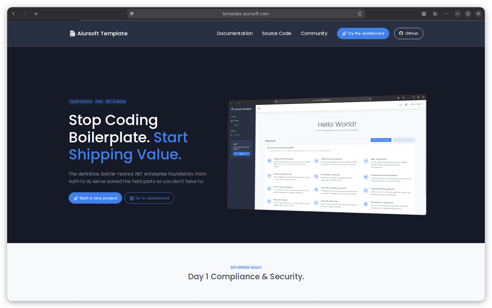

# Aiursoft Template

[](https://github.com/aiursoftweb/template/blob/master/LICENSE)
[](https://gitlab.aiursoft.com/aiursoft/template/-/pipelines)
[](https://gitlab.aiursoft.com/aiursoft/template/-/pipelines)
[](https://s360.aiursoft.com/SupplyChain?tab=projects&project=aiursoft%2Ftemplate&scope=baseline&ecosystem=all)
[](https://manhours.aiursoft.com/r/github.com/aiursoftweb/template.html)
[](https://template.aiursoft.com)
[](https://hub.docker.com/r/aiursoft/template)

Aiursoft Template is an ASP.NET Core application foundation with shared accounts, roles, file storage, localization and deployment conventions.



## Overview

Use Template as the starting point for an application that needs local or OIDC sign-in, permission-based access, shared UI components and persistent storage. See [projects using Template](docs/development.md#projects-using-aiursoft-template) for examples.

## Try

Try [Aiursoft Template](https://template.aiursoft.com).

## Install with Docker

Run the installer with the desired port:

```bash
curl -fsSL https://raw.githubusercontent.com/aiursoftweb/template/master/install.sh | sudo bash -s -- 8080
```

Open `http://localhost:8080` after installation completes.

## Run manually

Install the [.NET 10 SDK](https://dotnet.microsoft.com/download/dotnet/10.0) and [Node.js](https://nodejs.org/).

From the repository root, prepare the frontend assets:

```bash
npm ci --prefix src/Aiursoft.Template/wwwroot
npm run build --prefix src/Aiursoft.Template/wwwroot
```

Start the web application:

```bash
dotnet run --project src/Aiursoft.Template/Aiursoft.Template.csproj -- --urls http://localhost:5000
```

Open `http://localhost:5000`.

On an empty database, the default local account is `admin@default.com` with password `Admin@123456!`. Change the password before exposing the application.

## Run in Microsoft Visual Studio

Prepare the frontend assets as described above. Open `Aiursoft.Template.sln`, select `Aiursoft.Template` as the startup project, and press **F5**.

## Run in Docker

Pull and start the published image:

```bash
docker pull aiursoft/template
docker run -d --name template --restart unless-stopped \
  -p 8080:5000 --mount type=volume,source=template-data,target=/data \
  aiursoft/template
```

Open `http://localhost:8080`. Keep `/data` persistent across container replacements.

| Property | Value |
| --- | --- |
| Image | `aiursoft/template` |
| Container port | `5000` |
| Binary directory | `/app` |
| Persistent data | `/data` |
| Configuration | `/data/appsettings.json` |

## Usage

Sign in to explore user and role management, files and application settings. The default setup runs locally; configure OIDC when using an external identity provider.

### apt package filesystem layout

When installed via `apt install aiursoft-template`, the following paths are created:

| Role | Path | `apt remove` | `apt purge` |
|------|------|:---:|:---:|
| Working directory & binaries | `/usr/share/aiursoft-template/` | ✓ | ✓ |
| Config file | `/etc/aiursoft-template/appsettings.json` | | ✓ |
| Runtime data (DB, storage, keys) | `/var/lib/aiursoft-template/` | | |
| systemd unit | `/lib/systemd/system/aiursoft-template.service` | ✓ | ✓ |

The config file is a dpkg conffile — kept on `remove`, deleted only on `purge`.
Runtime data under `/var/lib/aiursoft-template/` is user data and intentionally never removed by dpkg.

See [the usage guide](https://template-docs.aiursoft.com/) for more examples.

## Configuration

See [the configuration reference](docs/configuration.md) for available settings. Environment variable names use double underscores, such as `Logging__LogLevel__Default`.

<a name="configuration-guide"></a>

The defaults use SQLite, local accounts and local file storage. Configure optional MySQL, OIDC or ClickHouse dependencies only after preparing the required services. The [configuration guide](docs/configuration.md) explains each setting.

## Documentation

- [User and application development documentation](https://template-docs.aiursoft.com/)
- [Configuration and persistence](docs/configuration.md)
- [Build, tests and README conventions](docs/development.md)
- <a name="projects-using-aiursoft-template"></a>[Projects using Template](docs/development.md#projects-using-aiursoft-template)
- <a name="cli--sdk"></a><a name="readme-structure"></a>[README structure](docs/development.md#readme-structure)

## How to contribute

Report bugs and feature requests through the [issue tracker](https://github.com/AiursoftWeb/template/issues). Create a feature branch or fork and submit a merge request or pull request for review.

Follow the [development guide](docs/development.md) to build and run the existing checks before submitting changes.

## License

Licensed under the [MIT License](LICENSE).
